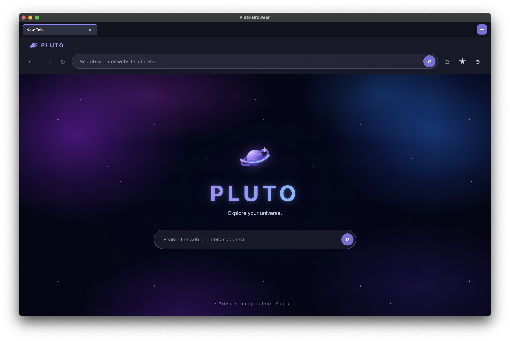
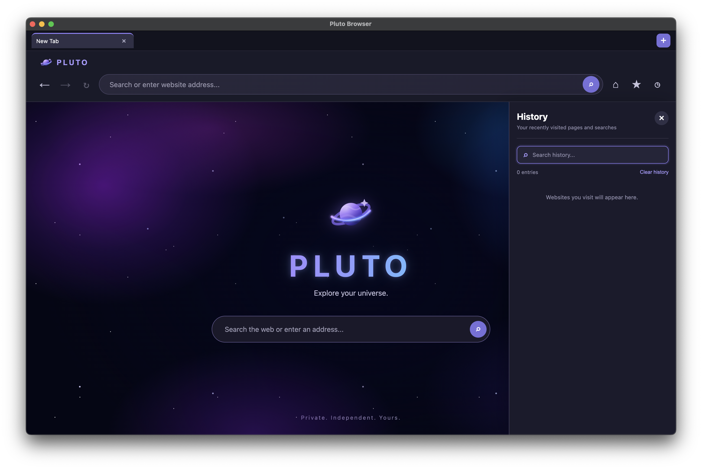

# 🌌 Pluto Browser

**A personal desktop web browser built with Electron, HTML, CSS, and JavaScript.**

Pluto is a learning project focused on exploring how desktop browsers work. It includes essential browser features such as multiple tabs, web navigation, bookmarks, browsing history, and privacy-focused search integration.

The goal is to build a simple, clean, and user-friendly browser while learning desktop application development.

## ✨ Features

- **Multiple Tabs:** Open, switch between, and close multiple browser tabs.
- **Web Navigation:** Visit websites with back, forward, reload, and home controls.
- **Search Integration:** Search the web using a locally running SearXNG instance.
- **Bookmarks:** Save your favourite websites and manage saved links.
- **Browsing History:** Automatically record visited websites and searches.
- **History Side Panel:** View your history in a convenient right-side panel without leaving your current website.
- **History Search:** Find previously visited websites and search queries.
- **History Management:** Delete individual entries or clear your browsing history.
- **Custom Homepage:** A Pluto-themed homepage with a built-in search field.
- **Keyboard Shortcuts:** Use shortcuts for common browser actions.
- **Permission Control:** Website permission requests are denied by default.

## 📸 Screenshots

### Pluto Homepage



### Browsing History Side Panel



## 🛠️ Built With

- [Electron](https://www.electronjs.org/) – Desktop application framework
- HTML – Application structure
- CSS – Styling and user interface
- JavaScript – Application functionality
- [SearXNG](https://docs.searxng.org/) – Privacy-focused metasearch integration

## 🚀 Getting Started

Follow these steps to run Pluto on your computer.

### Prerequisites

Make sure you have installed:

- [Node.js](https://nodejs.org/)
- npm (included with Node.js)
- [Git](https://git-scm.com/)

### Installation

**1. Clone the repository**

```bash
git clone https://github.com/ParamMavani/pluto-browser.git
```

**2. Navigate to the project folder**

```bash
cd pluto-browser
```

**3. Install dependencies**

```bash
npm install
```

**4. Start Pluto**

```bash
npm start
```

Pluto should now open on your desktop.

## 🔎 Search Engine Setup

Pluto currently uses a locally running SearXNG instance for web searches.

By default, Pluto connects to:

```text
http://localhost:8080
```

To use search functionality, you need a compatible SearXNG instance running locally at this address.

**Note:** Normal website browsing does not require SearXNG. Only the integrated search functionality depends on it.

SearXNG is maintained separately and is not included in this repository.

Documentation: [SearXNG Documentation](https://docs.searxng.org/)

## ⌨️ Keyboard Shortcuts

| Shortcut (macOS) | Action |
|---|---|
| `⌘ + T` | Open a new tab |
| `⌘ + W` | Close the current tab |
| `⌘ + L` | Focus the address bar |
| `Escape` | Close the open panel or exit its current interaction |

## 📁 Project Structure

```text
pluto-browser/
│
├── assets/
│   ├── pluto-logo.svg
│   └── screenshots/
│       ├── pluto-homepage.png
│       └── pluto-history.png
│
├── main.js
├── preload.js
├── renderer.js
├── index.html
├── style.css
│
├── package.json
├── package-lock.json
├── .gitignore
├── .gitattributes
└── LICENSE
```

## 🔐 Security

Pluto includes several security measures:

- Context isolation enabled.
- Node.js integration disabled in browser content.
- Sandboxed renderer processes.
- Restricted and validated IPC communication.
- Website navigation limited to HTTP and HTTPS protocols.
- Website permission requests denied by default.
- Content Security Policy configured for the local browser interface.

## 🎯 Learning Goals

This project helps explore:

- Desktop application development using Electron.
- Browser architecture and tab management.
- Communication between main and renderer processes.
- Secure communication using preload scripts and IPC.
- Web navigation and browsing history.
- Persistent local data storage.
- Integration with privacy-focused search engines.

## 🔮 Future Improvements

Some ideas for future development:

- Download manager.
- Browser history improvements.
- User-controlled website permissions.
- Configurable search engine providers.
- Better privacy controls.
- Cross-platform packaging and distribution.

## 📄 License

Please see the [LICENSE](LICENSE) file for licensing information.

## 👨‍💻 Author

**Param Mavani**

GitHub: [@ParamMavani](https://github.com/ParamMavani)

---

*Pluto is a personal learning project and is actively being developed.*